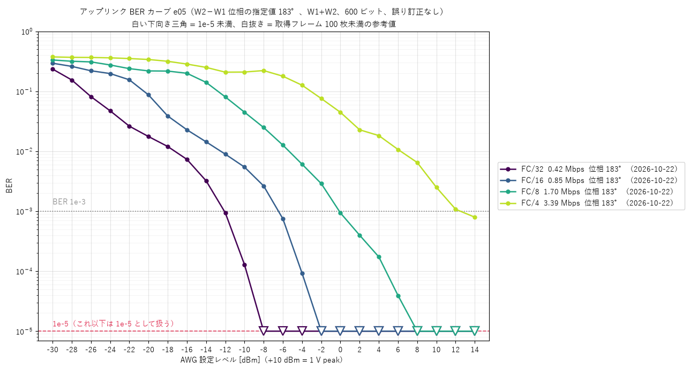
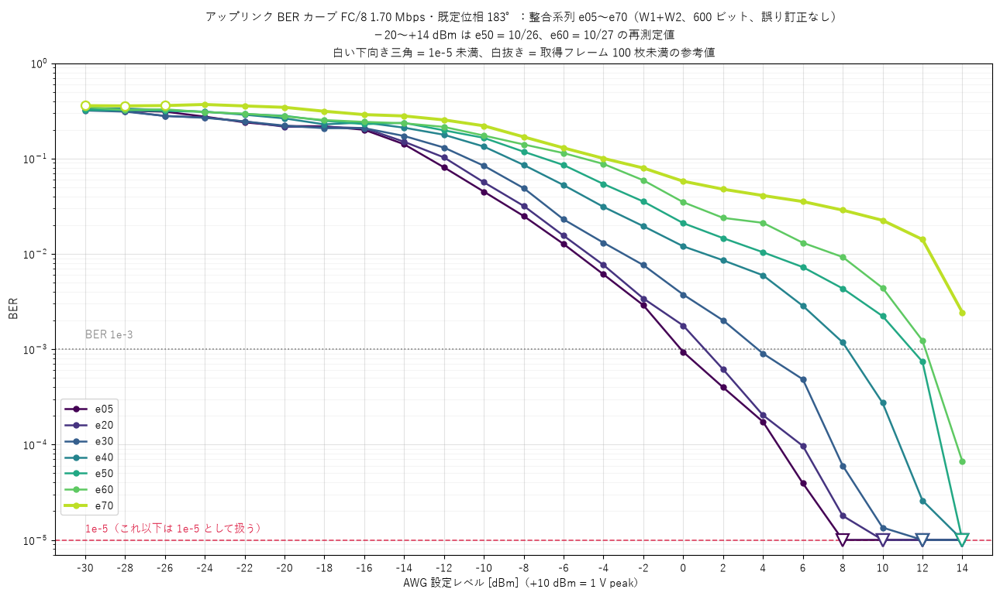
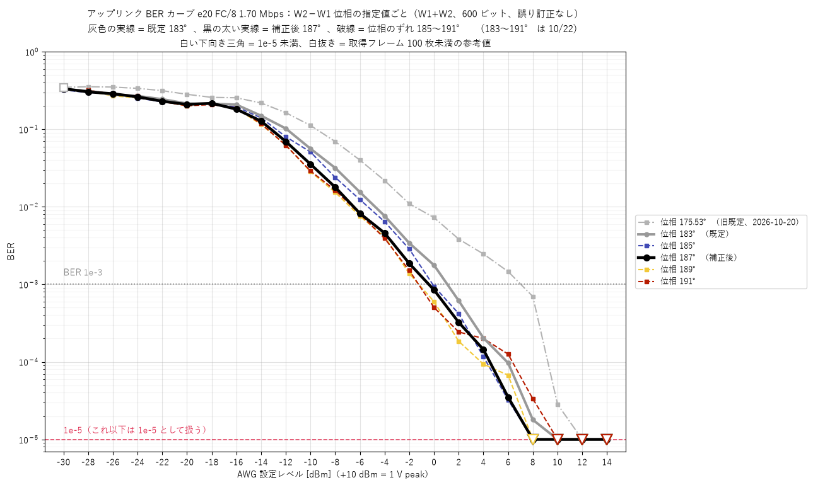
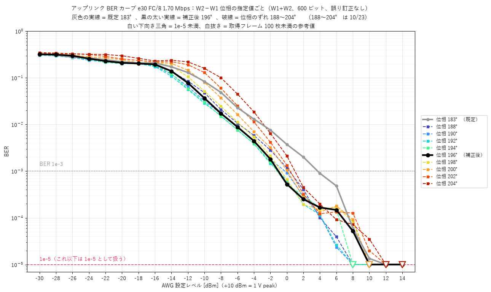
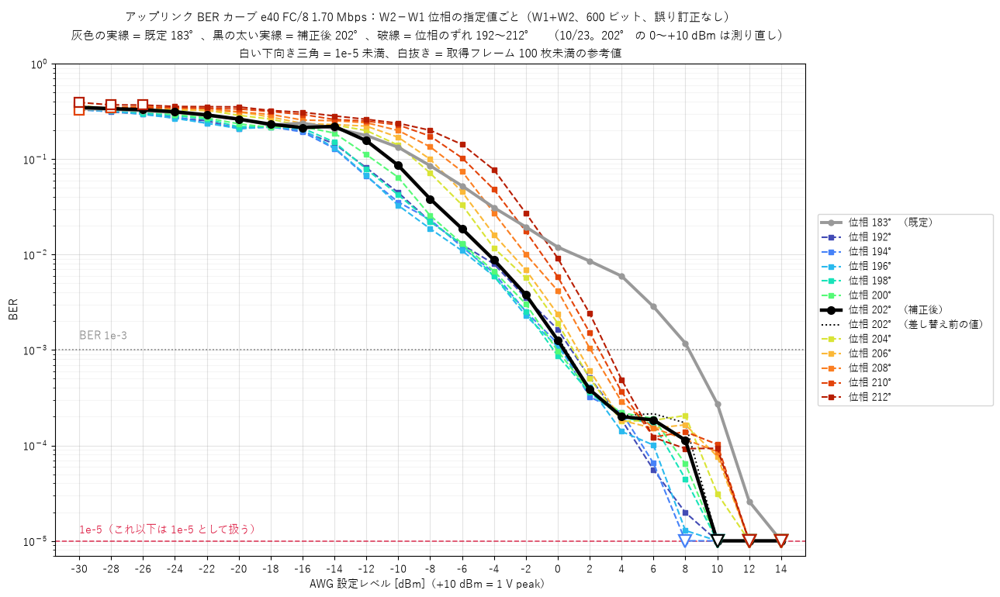
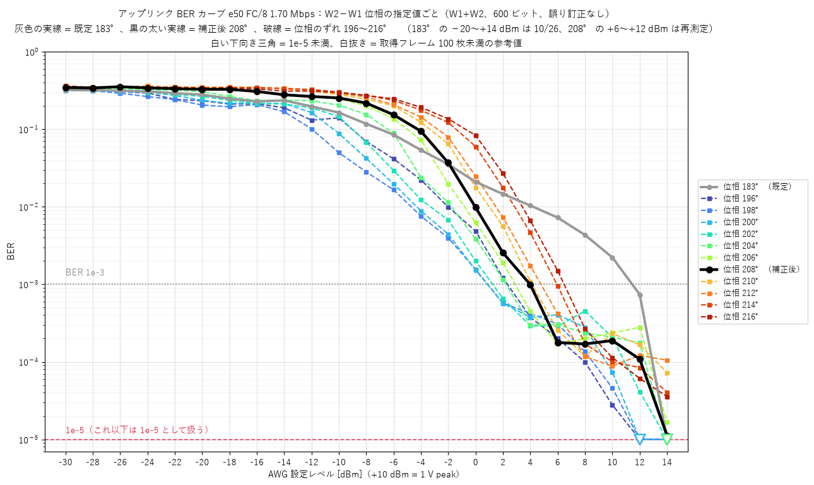
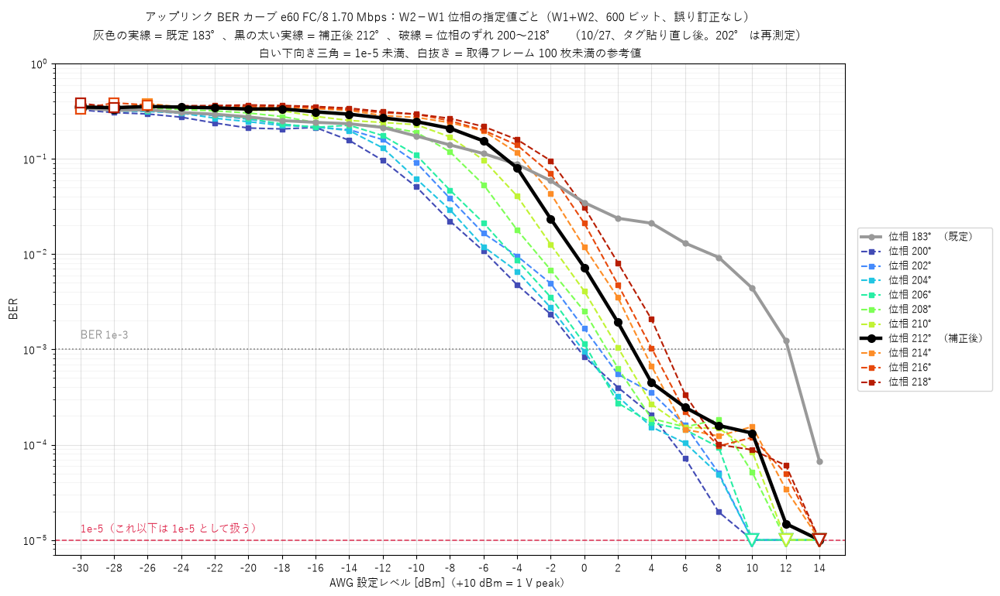
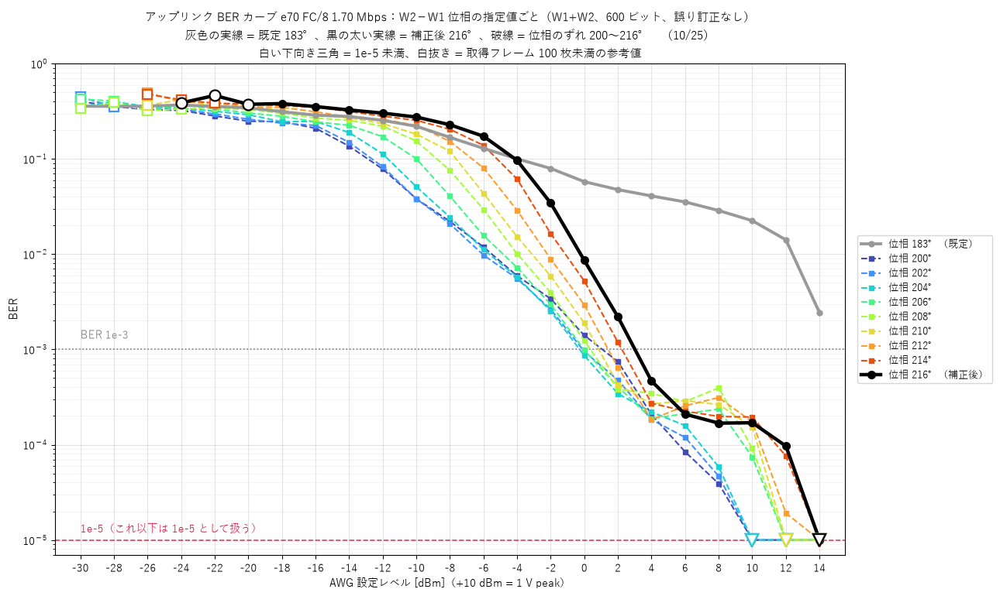

# NFC VHBR アップリンク BER カーブ

ADP3250 ツインコイルブリッジで測った、NFC VHBR アップリンクの BER（ビット誤り率）の図です。
測定は `2026_nfc_vhbr_ber` で行いました（2026-10-20〜10-27）。

## 測定条件

| 項目 | 内容 |
|---|---|
| 駆動 | W1+W2 |
| フレーム | 600 ビット |
| 誤り訂正 | なし |
| 横軸 | AWG の設定レベル（+10 dBm = 1 V peak） |
| 位相 | リーダの W2−W1 位相差の**指定値**。既定は 183° |
| 1 点の測り方 | 誤り 100 個以上かつ 60 万ビット以上、または 1e7 ビットに達するまで。弱いレベルは 150〜300 秒で打ち切り |

図の読み方：

- **1e-5 未満**の点は、1e-5 の線上に白抜きの下向き三角で描いています。
- **白抜きの点**は、取れたフレームが 100 枚未満なので参考値です。

## 図 1　e05：データレートの比較（位相 183°）

データレートが低いほど、弱い信号でも BER が下がります。BER 1e-3 を切るレベルは次のとおりです。

| データレート | 1e-3 を切るレベル |
|---|---|
| FC/32（0.42 Mbps） | 約 −12 dBm |
| FC/4（3.39 Mbps） | 約 +12 dBm |

データ：[e05_fcN_183.csv](e05_fcN_183.csv)

## 図 2　FC/8・位相 183°：整合系列 e05〜e70 の比較

整合系列は e05 → e70 の順に悪くなっています。BER 1e-3 を切るレベルは次のとおりです。

| 系列 | 1e-3 を切るレベル |
|---|---|
| e05 | 約 0 dBm |
| e40 | 約 +8 dBm |
| e70 | +14 dBm まで上げても切らない |

e50 と e60 の −20〜+14 dBm は再測定の値です（e50 は 10/26、e60 は 10/27）。

データ：[fc8_183_series.csv](fc8_183_series.csv)

## 図 3〜8　系列ごとの位相補正（FC/8）

凡例の見方：

- **灰色の実線**：既定の 183°（補正前）
- **黒の太い実線**：補正後の位相
- **色付きの破線**：補正後の位相の前後に位相をずらしたもの

BER 1e-3 を切るレベル（補正前 → 補正後）：

| 系列 | 補正後の位相 | 183°（補正前） | 補正後 |
|---|---|---|---|
| e20 | 187° | +1.1 dBm | −0.4 dBm |
| e30 | 196° | +3.7 dBm | −1.0 dBm |
| e40 | 202° | +8.2 dBm | +0.4 dBm |
| e50 | 208° | +11.5 dBm | +4.0 dBm |
| e60 | 212° | +12.1 dBm | +2.9 dBm |
| e70 | 216° | 切らない | +3.0 dBm |

e50〜e70 では、補正後の位相より 10° ほど小さい位相のほうが BER が良くなりました。最も良かった位相は e50 が約 198°、e60 が約 200〜204°、e70 が約 202° です。

### e20

旧既定値 175.53°（10/20）を灰色の一点鎖線で重ねています。

データ：[phase_e20.csv](phase_e20.csv)

### e30

データ：[phase_e30.csv](phase_e30.csv)

### e40

補正後 202° の 0〜+10 dBm は測り直した値です。黒の点線は、測り直す前の 1 回目の値です。

データ：[phase_e40.csv](phase_e40.csv)

### e50

補正後 208° の +6〜+12 dBm は再測定の値です。

データ：[phase_e50.csv](phase_e50.csv)

### e60

10/27 にタグを貼り直したあとに測った値です。202° は測り直した値です。

データ：[phase_e60.csv](phase_e60.csv)

### e70

データ：[phase_e70.csv](phase_e70.csv)

## 自分で描き直すには

- **ノートブック**：[ber_plots.ipynb](ber_plots.ipynb) は、このフォルダの CSV だけを読んで上の 8 枚を描きます。必要なのは matplotlib と Python の標準ライブラリだけです。`figures/` の PNG は、このノートブックの出力をそのまま保存したものです。
- **CSV の列**：`series, div, rate_mbps, phase_deg, role, date, level_dbm, bits, errors, ber, frames, expected, note`
  - `ber` は `errors / bits` です。
  - `role` の値と意味：

    | `role` | 意味 |
    |---|---|
    | `default` | 既定 183° |
    | `corrected` | 補正後 |
    | `sweep` | 位相のずれ |
    | `original` | 差し替える前の値 |
    | `175.53` | 旧既定値 |

  - 測り直して差し替えた点には `note` を付けています。
- **CSV を作り直すには**：[make_csv.py](make_csv.py) で作り直せます。これは隣の `2026_nfc_vhbr_ber/results` にある測定データ（JSON）を読むので、そのフォルダがある環境でだけ動きます。
