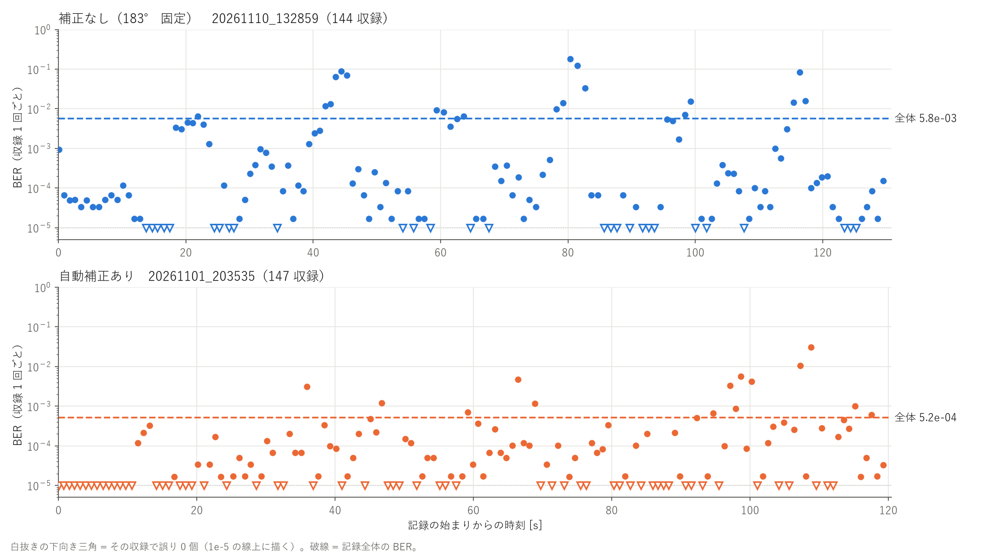
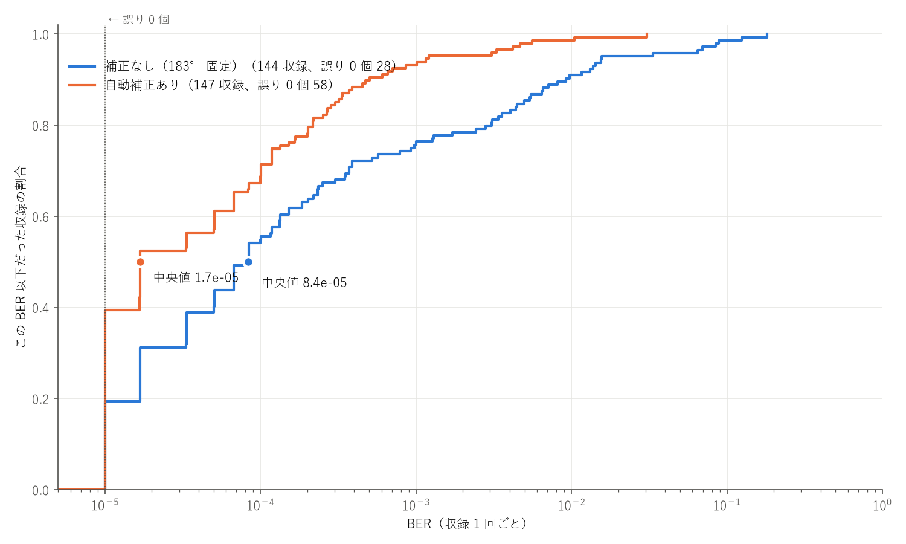
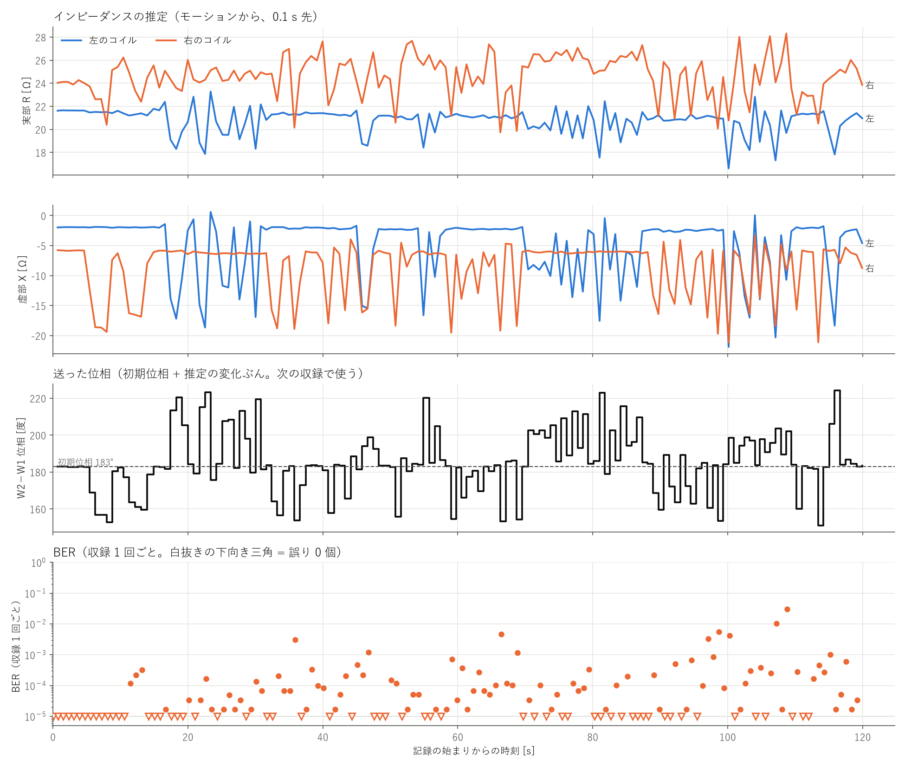

# 着用時の BER：位相の自動補正なし / あり

服を着た状態で動きながら測った、NFC VHBR アップリンクの BER（ビット誤り率）です。
2 つの記録を比べます。どちらも `motion_ber_gui.py` で、OptiTrack のモーション・カメラ・生データ付きで記録しました。

| | 補正なし | 自動補正あり |
|---|---|---|
| 記録 | `20261102_160447_FC8_600bit_+10dBm_183deg` | `20261101_203535_FC8_600bit_+10dBm_183deg` |
| W2−W1 位相（指定値） | 183° 固定 | 初期位相 183° ＋ 推定の変化ぶん（151〜224°） |
| 長さ・収録 | 31.5 秒・46 収録 | 119.2 秒・147 収録 |
| 共通 | AWG +10 dBm、FC/8（1.695 Mbps）、振幅比 1.0、1 回の収録 0.05 秒（約 99 フレーム、約 6 万ビット）、誤り訂正なし | |

自動補正は、モーション（7 マーカー）から 0.1 秒先の左右のコイルのインピーダンスを推定し、ブリッジの
打ち消しが最も深くなる位相を求めて、その**変化ぶん**だけ初期位相からずらすものです（`imp_phase_model.py`、`phase_control.py`）。
収録 1 回ごとに推定して、次の収録の前に送ります。

図の読み方：

- 点は収録 1 回（0.05 秒）ごとの BER です。**誤り 0 個**の収録は、1e-5 の線上に白抜きの下向き三角で描いています
  （1 収録が約 6 万ビットなので、誤り 1 個でも 1.7e-5 になります）。
- 2 つの記録は別の日・別の動きなので、**同じ動きで補正の有無だけを変えた比較ではありません**。

## 図 1　収録ごとの BER の推移



| | 補正なし | 自動補正あり |
|---|---|---|
| 記録全体の BER | **8.4×10⁻³**（23,064 / 2,737,800） | **5.2×10⁻⁴**（4,583 / 8,747,400） |
| 誤り 0 個の収録 | 1 / 46 | 58 / 147 |
| 収録ごとの BER の中央値 | 2.1×10⁻⁴ | 1.7×10⁻⁵ |
| 収録ごとの BER の 90 % 点 | 3.5×10⁻² | 4.8×10⁻⁴ |

補正なしは、3〜11 秒に BER が 3〜5×10⁻² の区間が続き、記録全体の BER をほぼ決めています。
自動補正ありは、大半の収録が 1e-4 以下で、1e-2 を超えたのは 105〜110 秒の 2 収録だけでした。

## 図 2　収録ごとの BER の分布



横軸の BER 以下だった収録の割合です（左ほど良い）。自動補正ありは約 4 割の収録で誤り 0 個、約 7 割が 1e-4 以下です。
補正なしは 2 割強が 1e-2 を超えています。

## 図 3　インピーダンスの推定と送った位相（自動補正ありの記録）



上から、推定した左右のコイルのインピーダンス（実部 R・虚部 X）、送った位相、収録ごとの BER です。左右は本人の左右です
（記録のときは Motive のラベルが左右逆だったので、推定には入れ替えた名前を渡しています）。

| | 平均 | 最小 〜 最大 | 標準偏差 |
|---|---|---|---|
| 左のコイル R | 20.8 Ω | 16.6 〜 23.3 Ω | 1.1 Ω |
| 左のコイル X | −5.0 Ω | −21.9 〜 +0.6 Ω | 5.0 Ω |
| 右のコイル R | 24.6 Ω | 19.7 〜 28.3 Ω | 1.8 Ω |
| 右のコイル X | −8.7 Ω | −21.2 〜 −3.3 Ω | 4.6 Ω |
| 補正量（初期位相からのずれ） | +2.1° | −31.9 〜 +41.2° | 16.3° |
| 送った位相 | 185.1° | 151.1 〜 224.2° | 16.3° |

- 腕を下ろしているときは、左 X ≈ −2 Ω、右 X ≈ −6 Ω でほぼ一定です。腕を動かすと X が −15〜−22 Ω まで下がり、
  それに合わせて位相が 150〜225° の範囲で動いています。R の変化は X より小さめです（標準偏差 1〜2 Ω）。
- 位相は 147 回のうち 144 回送りました（残りは前回と同じ値だったので送っていません）。
- 補正量が大きかった収録（|補正量| が中央値 6.2° 以上）の次の収録は平均 BER 9.9×10⁻⁴、小さかった収録の次は 6.7×10⁻⁵ でした。
  大きく動いている所ほど補正量も BER も大きくなるので、**補正が BER を悪くしたことを示すものではありません**。
- インピーダンスは**モーションから推定した値**で、VNA で測った値ではありません。

## ファイル

| | |
|---|---|
| [ber_captures.csv](ber_captures.csv) | 2 つの記録の、収録 1 回ごとの BER（図 1・図 2） |
| [imp_20261101.csv](imp_20261101.csv) | 自動補正ありの記録の、収録 1 回ごとのインピーダンスの推定・送った位相・次の収録の BER（図 3） |
| [summary.json](summary.json) | 上の表の数値 |
| [make_figs.py](make_figs.py) | CSV と図を作るスクリプト（列の意味も書いてある） |
| [camera_videos.zip](camera_videos.zip) | 2 つの記録のカメラの動画（`<記録フォルダ名>/camera.mp4`）と、その各フレームの時刻（`camera_frames.csv`）。35 MB |

```bash
uv run python video/make_figs.py              # CSV から図を描き直す（このリポジトリだけで動く）
uv run python video/make_figs.py --from-logs  # 記録フォルダ（~/nfc_vhbr_captures/log）から CSV を作り直してから描く
```

カメラの動画だけは、このフォルダの `camera_videos.zip` に入っています。`camera_frames.csv` の時刻は
`ber_motion.csv`・`motion.csv` と同じ時計（`perf_counter`）なので、BER やモーションと突き合わせられます。

生データを含む記録フォルダ全体（約 1.9 GB）は、記録フォルダごとの zip にして Google Drive に置きます。

- [Google Drive の記録フォルダ](https://drive.google.com/drive/folders/1NELo1Kkab1Da-zkV7CM_7vmiJ3R7sgG6?usp=drive_link)
  - `20261102_160447_FC8_600bit_+10dBm_183deg.zip`（補正なし、318 MB）
  - `20261101_203535_FC8_600bit_+10dBm_183deg.zip`（自動補正あり、1.0 GB）

`~/nfc_vhbr_captures/log/` に展開すると、`uv run motion_ber_gui.py --replay <記録フォルダ名>` で再生でき、
`--from-logs` で CSV も作り直せます。中身は生データ（`cap_*.ad3`）・動画・モーション・BER の CSV・再生用のキャッシュ、
左右のラベルを直す前のバックアップ（`_before_fix_lr/`）です。
